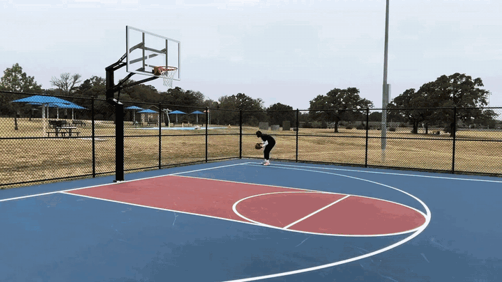

<h2 align="center">
  
  Plumb: Coding Agents with 3D Perception Rebuild Physical Scenes from Video
</h2>

<h5 align="center">

Xiaoqian Liang<sup>1</sup>,
[Hongyuan Chen](https://hyuanchen.github.io/)<sup>1</sup>,
[Binbin Huang](https://hbb1.github.io/)<sup>2</sup>,
[Anpei Chen](https://apchenstu.github.io/)<sup>1</sup>

<sup>1</sup>Westlake University, <sup>2</sup>The University of Hong Kong
</h5>

Plumb: An Agent Harness for Inverse Physics of Dynamic Scenes.

<p align="center">
  <a href="assets/basketball.mp4"></a>
</p>

## Installation

Requirements: Linux, an NVIDIA GPU with CUDA 12.x, conda, and access to the gated
[facebook/sam3](https://huggingface.co/facebook/sam3) checkpoint.

```bash
git clone --recursive git@github.com:Inception3D/Plumb.git && cd Plumb   # SAM 3 and Pi3 come in third_party/
sudo apt-get install -y ffmpeg libegl1 libgl1 libegl-mesa0
```

**1. Agent environment** (MuJoCo and the helper commands, CPU only)

```bash
python3 -m venv .venv && .venv/bin/pip install -r requirements.txt
```

**2. SAM 3**

```bash
conda create -n sam3 python=3.12 -y && conda activate sam3
pip install torch torchvision --index-url https://download.pytorch.org/whl/cu128   # match your CUDA
pip install -e third_party/sam3 opencv-python decord psutil einops pycocotools
hf auth login && hf download facebook/sam3 sam3.pt
```

**3. Pi3X**

```bash
conda create -n pi3 python=3.12 -y && conda activate pi3
pip install -r third_party/Pi3/requirements.txt
hf download yyfz233/Pi3X model.safetensors --local-dir checkpoints/Pi3X
```

**4. Configure and check the GPU service**

```bash
cp src/harness/gpu.env.example src/harness/gpu.env   # set the SAM 3 / Pi3 Pythons and the Pi3X weights
python3 src/harness/gpu_service.py --check            # prints "sam3: ok" and "pi3x: ok"
```

## Usage

```bash
# Run from the repository root.
# 1. Create a task directory for one video (input/video.mp4, read-only tools, PROMPT.md)
python3 src/harness/new_task.py my_video.mp4 tasks/my_video

# 2. Serve the GPU tools while the agent runs (in another shell; GPU indices, one job per entry)
python3 src/harness/gpu_service.py tasks/my_video 0

# 3. Run the agent in the task directory
export REAL2SIM_PYTHON=$PWD/.venv/bin/python
cd tasks/my_video && export PYTHONPATH=$PWD
codex exec --skip-git-repo-check --sandbox workspace-write -C . - < PROMPT.md
# or, in a container / VM: claude -p "$(cat PROMPT.md)" --allowedTools "Bash Read Edit Write"
```

The agent writes `scene.xml`, `initial_state.json`, `parameters.json`, `run.py` and `preview.mp4` to `output/`.
To check the deliverables and rerun the simulation:

```bash
$REAL2SIM_PYTHON -m r2s deliver --validate-only
$REAL2SIM_PYTHON output/run.py --headless --duration 8 --output rerun --render
```

To serve several tasks, pass their parent directory instead (`gpu_service.py tasks 0,0,1`).

The benchmark of the paper (50 PhysInOne / Physion videos, download, build and evaluation) is in
[benchmark/](benchmark/README.md).

## Citation

```bibtex
@misc{liang2026plumb,
  title        = {Plumb: Coding Agents with 3D Perception Rebuild Physical Scenes from Video},
  author       = {Liang, Xiaoqian and Chen, Hongyuan and Huang, Binbin and Chen, Anpei},
  year         = {2026},
  howpublished = {Blog post},
  url          = {https://yubel426.github.io/Plumb/}
}
```

## License

MIT ([LICENSE](LICENSE)). SAM 3 and Pi3X are installed separately and keep their own licenses. The Pi3X weights are
for non-commercial use only. See [THIRD_PARTY_NOTICES.md](THIRD_PARTY_NOTICES.md).
